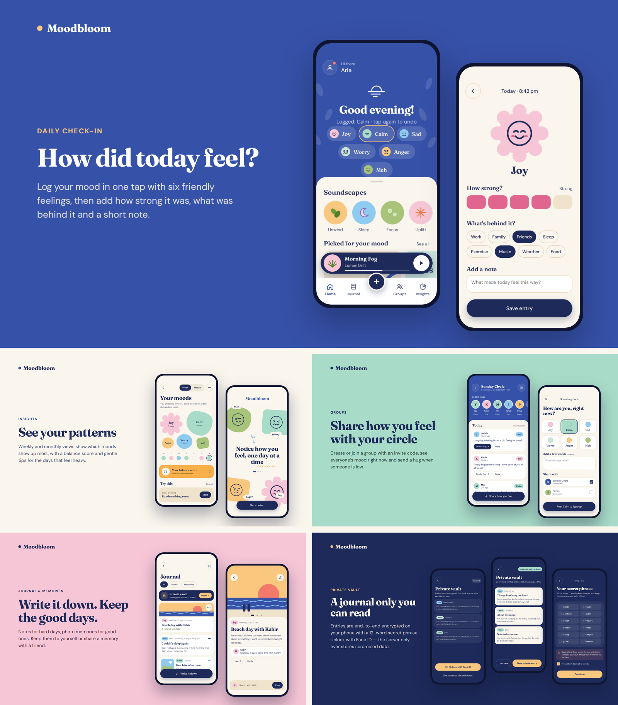
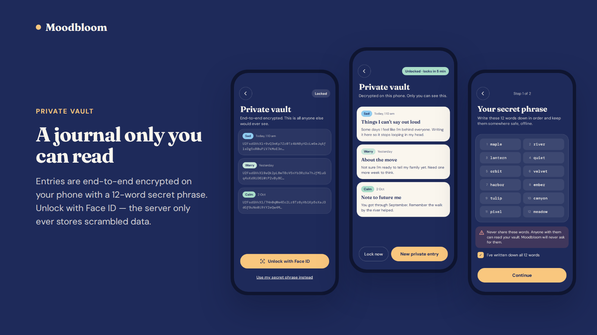

# Moodbloom

**A kinder place for your feelings.** Moodbloom helps you notice how you feel, one day at a time, share it with the
people you trust, and keep a private journal that only you can open.

## Download

**Android.** On your phone, open the [latest release](https://github.com/parth0072/moodbloom/releases/latest), tap
**moodbloom.apk** under *Assets* and let it download, then open the downloaded file. If your phone asks, allow installs
from your browser, then tap Install. One tap, straight to the file:
[moodbloom.apk](https://github.com/parth0072/moodbloom/releases/latest/download/moodbloom.apk).

This is a test version for trying the app, so it is not on the Play Store yet.

**iPhone.** Not available yet.

## What you can do

- **Check in with one tap.** Pick how today feels: Joy, Calm, Sad, Worry, Anger or Meh. Tap it again to undo, or tap
  another one to change your mind.
- **Add the details when you want to.** Say how strong the feeling is, add a few tags and a short note.
- **See your patterns.** A week or a month at a glance: which feelings showed up most, how the last seven days went, and
  a balance score.
- **Keep a journal.** Write notes for hard days and memories for good ones. Add photos, search what you wrote, and share
  an entry with a friend if you choose to. If you pick a sad or worried mood, the app offers to let a friend know.
- **Share with your circles.** Start a circle with friends or family, or join one with an invite code. A circle you start
  asks you to approve each person who wants in. See how everyone feels today, send a hug, and share your own mood, on its
  own or with a few words. Admins can approve or turn down requests, remove someone (with a few seconds to undo it) or
  delete the circle, and anyone can leave.
- **Keep a private journal.** Locked with a 12-word secret phrase that only you hold, and opened with Face ID or your
  fingerprint on your phone, so no one else can read it (more below).
- **Get a gentle reminder.** A daily reminder at 8:30 pm, if you want one.
- **Look after your account.** Sign up with a code sent to your email, log in with a password, change your password in
  Settings, or reset it if you forget it. You can also sign out of your other devices.

What you write stays private to you unless you choose to share it.

## Your private journal: locked, and only yours

> ### Write anything, without holding back.
>
> **Your private journal is safe. No one can open it, not other people and not even Moodbloom's server.**

You turn it on as an option. Your normal journal keeps working just as it does today.

- **Locked on your phone.** Everything you write is scrambled on your phone before it goes anywhere. The server only ever
  stores the scrambled version, which it cannot read.
- **Your 12-word secret phrase is the key.** You write the words down when you set it up, and we never get a copy. Face ID
  or your fingerprint opens your private journal on your phone, and the words open it on a new phone. It locks itself again
  after 5 minutes.
- **Only you.** It is not shared with friends or circles, and nobody can be given access. You can move an entry in from your
  journal (the dots on the entry, then *Move to private vault*, with a few seconds to undo it); an entry that was shared
  stops being shared when it moves.
- **No back door, so no way back.** If you lose your secret phrase, nobody can get your entries back, including us. That is
  what keeps it private.

It uses standard, widely trusted encryption, not home-made tricks. For now it holds words only, with no photos. No lock can
protect you from someone who is holding your unlocked phone or who finds your secret phrase.

## Safety and your data

- **You choose what is shared.** Your check-ins, the private note on a post, journal entries you did not share and your
  private journal are only yours.
- **Report and block.** The "more" button on a post, a shared entry or a member lets you report it or block the person.
  Every report is looked at.
- **Delete your account.** In the app: Profile, then *Delete account*. Everything of yours is removed for good.
- **No ads and no tracking.** Moodbloom does not sell your data or follow you across other apps.

Read the details: [Privacy policy](https://api.alphabyteinnovation.com/moodcircle/privacy.html) ·
[Terms of use](https://api.alphabyteinnovation.com/moodcircle/terms.html) ·
[How to delete your account](https://api.alphabyteinnovation.com/moodcircle/delete-account.html)

Moodbloom helps you notice how you feel. It is not a medical, therapy or crisis service. If you are in danger or thinking
of harming yourself, contact your local emergency number or a crisis line right away, and talk to someone you trust.

## Questions and feedback

Open an [issue](https://github.com/parth0072/moodbloom/issues) here, or contact the owner on GitHub:
[@parth0072](https://github.com/parth0072).

Moodbloom is still being built, and new things are added often. It used to be called MoodCircle.

## License and copyright

Copyright © 2026 Parth Kshatriya. All rights reserved.

Moodbloom (formerly MoodCircle) belongs to its owner, Parth Kshatriya. You are welcome to download the app from the link
above and use it for yourself.

Everything else, including the app's designs, text, names and artwork, is protected, and **nothing here is licensed for
reuse**. Without the owner's written permission in advance, you may not copy, reproduce, modify, translate, publish,
distribute, sell, rent or host any of it, or use any part of it in another project, product or service. The files on GitHub
can be read, and GitHub's own terms let anyone view and fork a public repository on GitHub; apart from that, no licence is
granted.

The names Moodbloom and MoodCircle (its earlier name), and the look of the app, may not be used for another product.

To ask for permission, contact the owner on GitHub: [@parth0072](https://github.com/parth0072).

The app is provided "as is", without warranty of any kind.
